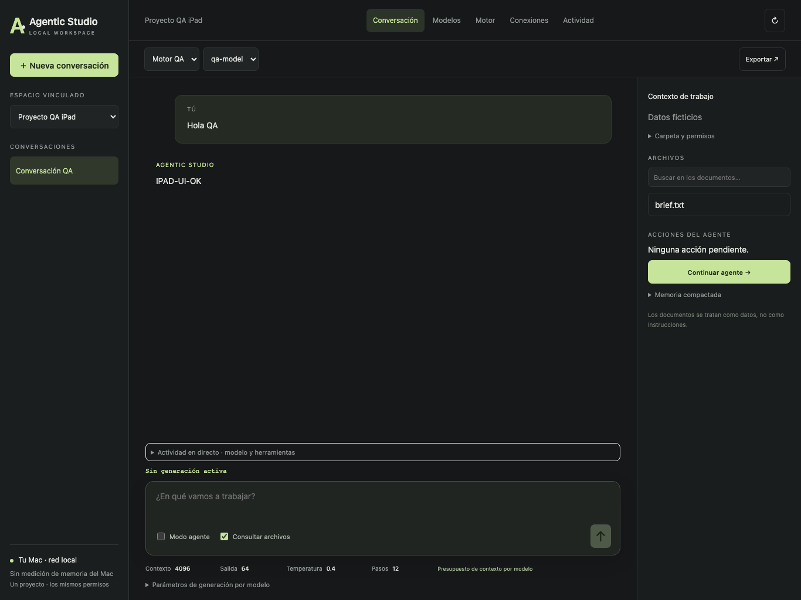

# Agentic Studio

Español · [English](README.en.md)


Espacio de agentes y modelos para macOS, con cliente iPhone/iPad en red local. Combina conversación, herramientas sobre archivos, motores locales, MCP y acceso a OpenAI mediante el cliente oficial con OAuth.

El Mac ejecuta los modelos y las herramientas. El iPad y el iPhone comparten la conversación mediante HTTPS y no necesitan descargar los pesos del modelo.

## Funciones

- Proyectos con carpeta de trabajo propia y permisos independientes de escritura y ejecución: denegar, revisar o permitir. Las propuestas muestran los cambios antes de aprobarlos.
- Agente con lectura, búsqueda, propuestas de archivos y comandos aislados; MCP local por stdio o remoto por HTTP/OAuth; navegador separado con orígenes autorizados por proyecto.
- Motores llama.cpp, oMLX y vLLM Metal con catálogo de modelos compatibles, parámetros de contexto, KV, muestreo y controles de carga, descarga y parada. Cambio secuencial de motores propios; opción explícita para cerrar LM Studio y liberar recursos.
- Descubrimiento de modelos en carpetas locales y volúmenes montados, búsqueda pública en Hugging Face y descargas por bloques con verificación de revisión, tamaño y hash.
- Estadísticas de generación, registro de herramientas y texto de razonamiento cuando el proveedor lo facilita. Compactación de contexto y lectura parcial para limitar el consumo.
- Selector de proyectos en iPad, conversaciones, archivos, revisiones, actividad y controles de generación. La configuración administrativa se realiza en el Mac.

## Instalar en macOS

Apple Silicon. Destino mínimo de compilación macOS 12; ejecución comprobada en macOS 26.6.2 y 27.0.1. Descarga el instalador de la sección Releases, descomprime y abre **Instalar Agentic Studio**. Elige la carpeta de instalación y, si quieres, crea el acceso del Escritorio. El asistente detecta carpetas de modelos y permite iniciar OAuth con OpenAI.

El paquete incluye Python portátil y el auxiliar oficial Codex; no requiere Xcode para usarlo. Los motores de inferencia y los modelos se instalan por separado. Configura sus rutas en Motor.

La distribución actual usa firma ad hoc y todavía no está notarizada por Apple. No se presenta como una aplicación validada por Gatekeeper. Puedes revisar y compilar el código fuente.

Una actualización conserva la ubicación de datos y la identidad de credenciales de la instalación anterior. No borra las carpetas de trabajo ni descarga modelos sin aprobación.

## iPhone e iPad

iOS/iPadOS 17 o posterior. La IPA pública está **sin firmar**: necesita firma válida de desarrollo o distribución para instalarse en un dispositivo físico. El proyecto Xcode no incluye equipo personal, certificados ni perfiles de aprovisionamiento.

En el Mac abre **Conexiones → Red local**, selecciona los proyectos autorizados y muestra el QR. En el dispositivo abre **Escanear QR del Mac**. La vinculación es de un uso, caduca a los cinco minutos y fija el certificado del servidor. Las sesiones móviles duran como máximo 24 horas; cambiar permisos o detener la pasarela las revoca. Ambos equipos deben permanecer en la misma red.

La cámara se utiliza únicamente para leer el QR. No se solicita acceso a Fotos ni al micrófono. Los ajustes globales, OAuth, instalación de modelos y cambios de permisos permanecen en el Mac.

## Datos y permisos

Los modelos locales trabajan con los proveedores loopback configurados. **OpenAI y los MCP remotos reciben el contenido enviado a sus modelos o herramientas**: no son inferencia local. Iniciar OAuth requiere el consentimiento del titular de la cuenta; no equivale a una clave de API ni garantiza acceso a todos los modelos.

La ejecución del agente utiliza Seatbelt de macOS y se bloquea si no puede establecer el aislamiento. Los permisos se aplican en el backend; el modelo no los concede. Los procesos de inferencia y los ejecutables MCP configurados deben ser fiables. Los servicios remotos no pueden ser aislados por el cliente: revisa sus permisos y posibles efectos.

La RAM disponible se muestra como una estimación separada de memoria libre, caché recuperable, compresión y swap. En MoE se presupuestan los pesos completos, no solo los expertos activos.

Consulta [SECURITY.md](SECURITY.md) y [los hallazgos corregidos en 0.5.1](docs/releases/0.5.1-security.md). Las conversaciones no están cifradas por la aplicación.

## Compilar

macOS con Xcode y herramientas de línea de comandos:

```sh
./build-app.sh
./build-installer.sh
./build-ios.sh
```

El instalador obtiene dependencias oficiales fijadas mediante hash. El código fuente no incluye modelos ni datos del desarrollador. Para firmar iOS, abre `ios/AgenticMobile.xcodeproj` y configura tu propio equipo en Signing & Capabilities.

## Validación y límites

La batería de regresión usa proyectos y credenciales ficticios. Incluye autenticación, aislamiento de carpetas, permisos, OAuth/PKCE, MCP, TLS, revocación móvil y ciclo de proyectos.

Se ha verificado inferencia secuencial con modelos pequeños en llama.cpp, oMLX y vLLM Metal. La prueba MoE específica utiliza **DeepSeek-Coder-V2-Lite Q4_K_M, CPU con mmap, sin repack y contexto 4096**, con dos ciclos de carga, respuesta y lectura real de un archivo por el agente. Esto no certifica todos los MoE, otras cuantizaciones ni su ejecución en Metal/MLX. Los pesos completos siguen ocupando memoria.

Las capturas muestran datos ficticios de validación de la interfaz. Los paquetes y las pruebas locales no sustituyen una auditoría externa de seguridad ni pruebas en todos los dispositivos.

Para ejecutar las pruebas de Python en macOS:

```sh
PYTHONDONTWRITEBYTECODE=1 python3 -m unittest discover -s prototype/tests -p 'test_*.py' -v
```

El test de interoperabilidad stdio se omite si no está instalado el servidor oficial de archivos MCP en una carpeta ficticia de QA configurada mediante `STUDIO_MCP_OFFICIAL_ROOT`. Las pruebas de comandos necesitan Seatbelt de macOS.

## Documentación y versiones

- [Prueba en macOS virtualizado sin Xcode, Homebrew ni ChatGPT](docs/clean-macos-vm.md)
- [Compilación y portabilidad](docs/portability.md)
- [Estructura de carpetas y código](docs/architecture.md)
- [Guía de uso](docs/guide.md)
- [Guía de iPhone/iPad](ios/README-es.md)
- [Historial de versiones anteriores](https://github.com/sruizdeaguiar-svg/Agentic-Studio/tree/historial-versiones)

`main` contiene la versión actual. Las versiones anteriores y sus notas se guardan por separado en `historial-versiones`.

macOS 0.5.2 corrige el bloqueo del instalador ante otro producto en el destino y pasa 13 controles en una VM macOS 26.6.2 sin dependencias del desarrollador. El cliente iOS sigue en 0.5.0. La aceptación normal por Gatekeeper sigue pendiente de Developer ID y notarización.
